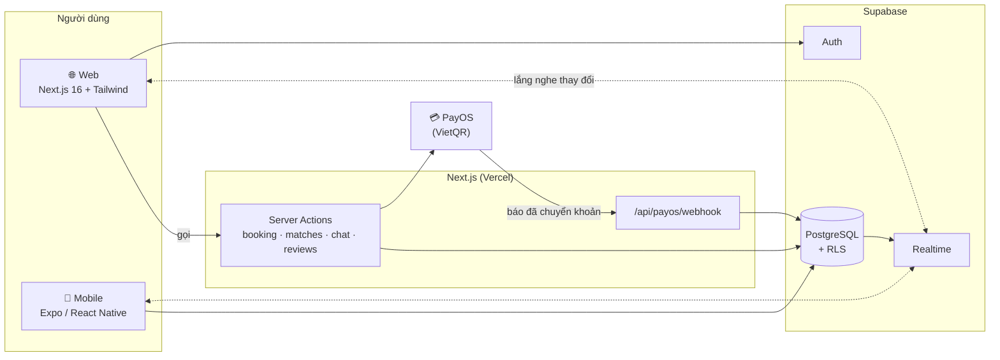
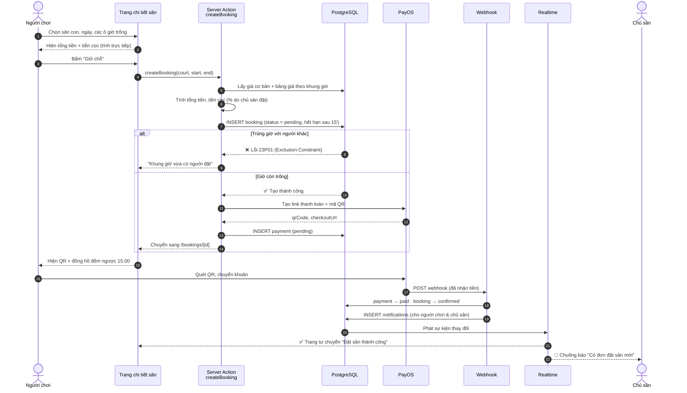
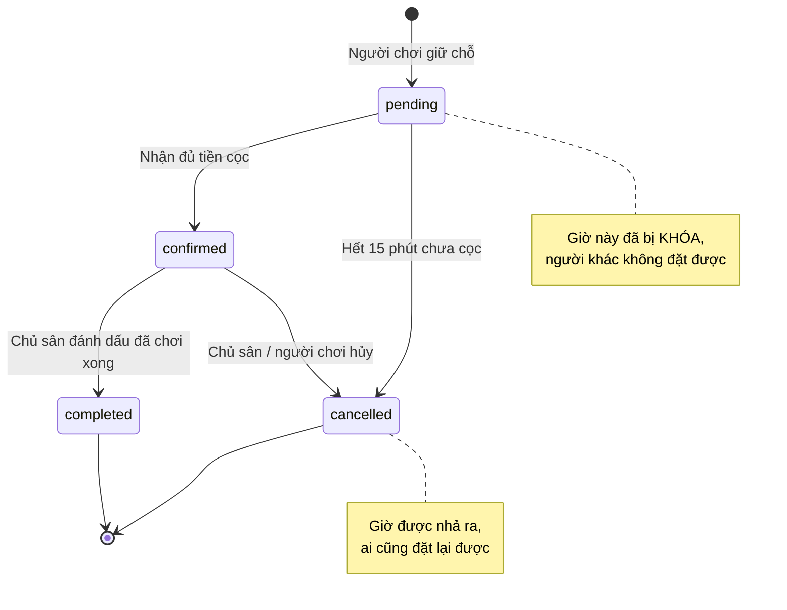
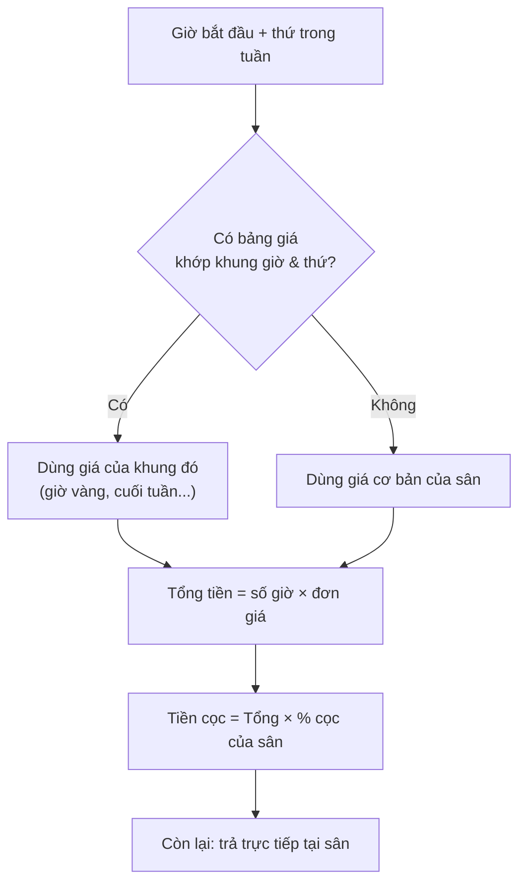
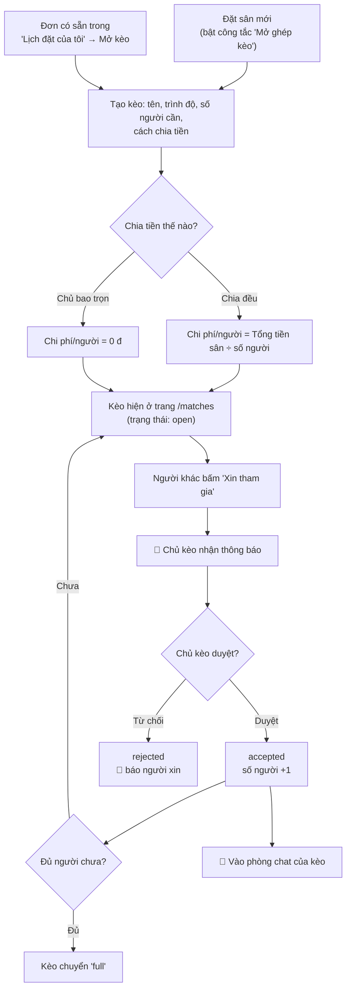
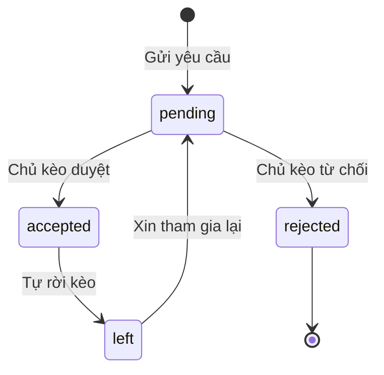
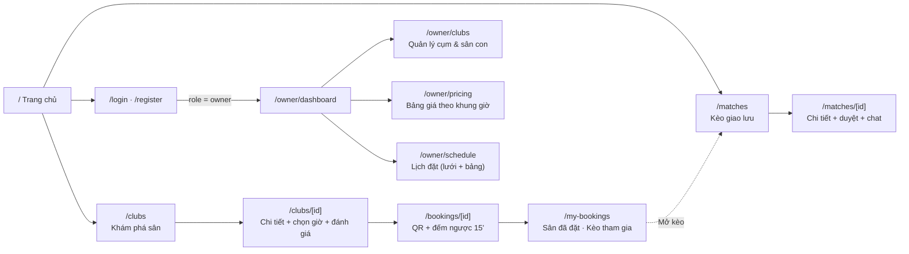
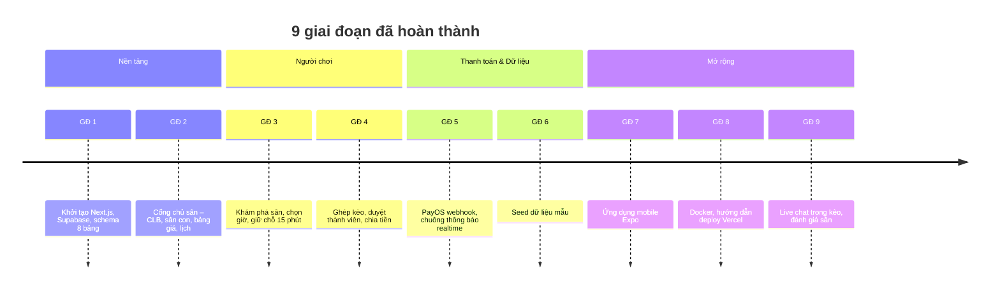

# 🏟️ SportArena — Luồng hoạt động của hệ thống

> Nền tảng **đặt sân + ghép kèo thể thao** theo thời gian thực.
> Tài liệu này giải thích *người dùng đi qua những bước nào* và *hệ thống xử lý gì phía sau*.
>
> 💡 **Xem sơ đồ:** mở file này rồi nhấn `Ctrl+Shift+V` trong VS Code (cần extension
> *Markdown Preview Mermaid Support*), hoặc xem trực tiếp trên GitHub – sơ đồ tự hiển thị.

---

## 1. Tổng quan trong 30 giây

| Vai trò | Làm được gì |
| :-- | :-- |
| 🏃 **Người chơi** | Tìm sân → chọn giờ → cọc bằng QR → mở/tham gia kèo → chat → đánh giá sân |
| 🏢 **Chủ sân** | Tạo cụm sân & sân con → đặt bảng giá theo khung giờ → xem lịch đặt realtime → nhận thông báo khi có cọc |
| 🤖 **Hệ thống** | Chống trùng lịch, giữ chỗ 15 phút, sinh QR, nhận webhook thanh toán, bắn thông báo realtime |

Có **3 con số** cần nhớ:

- ⏱️ **15 phút** – thời gian giữ chỗ chờ cọc
- 💰 **% cọc** – chủ sân tự đặt cho từng sân (mặc định 30%)
- 🔒 **0 lần trùng lịch** – do Postgres chặn ở tầng database, không phải ở code

---

## 2. Kiến trúc



**Điểm hay của thiết kế:** web không tự "hỏi lại" server liên tục. Khi database đổi (có cọc, có người xin vào kèo, có tin nhắn mới), **Supabase Realtime đẩy** thay đổi xuống trình duyệt → giao diện tự cập nhật.

---

## 3. Luồng chính: Đặt sân → Cọc → Xác nhận

Đây là luồng quan trọng nhất của sản phẩm.



### Vòng đời của một đơn đặt sân



### Vì sao không bao giờ trùng lịch?

Không kiểm tra bằng code (dễ bị 2 người bấm cùng lúc). Database có ràng buộc:

```sql
EXCLUDE USING gist (court_id WITH =, during WITH &&)
WHERE (status IN ('pending', 'confirmed'))
```

> Nghĩa là: **cùng một sân + khoảng giờ giao nhau + đơn còn hiệu lực = bị Postgres từ chối.**
> Ai bấm trước thì được, người sau nhận thông báo lỗi thân thiện.

### Cách tính giá



---

## 4. Luồng Ghép kèo (Matchmaking)

Người chơi đã có sân nhưng thiếu người → mở **kèo** để mọi người cùng tham gia.



### Trạng thái người tham gia



---

## 5. Realtime: ai nghe cái gì?

| Màn hình | Bảng được lắng nghe | Kết quả người dùng thấy |
| :-- | :-- | :-- |
| `/bookings/[id]` | `bookings` | Đang chờ cọc → tự chuyển "Thành công" |
| `/owner/schedule` | `bookings` | Lịch của chủ sân thêm đơn mới ngay lập tức |
| `/matches/[id]` | `match_participants`, `matches` | Danh sách thành viên & số chỗ trống tự đổi |
| Hộp chat trong kèo | `match_messages` | Tin nhắn mới hiện ngay, không cần F5 |
| Phần đánh giá sân | `club_reviews` | Review mới hiện ngay |
| 🔔 Chuông thông báo | `notifications` | Số đỏ tăng + popup |

---

## 6. Bản đồ trang (Web)



---

## 7. Cơ sở dữ liệu

```mermaid
erDiagram
    PROFILES ||--o{ CLUBS : "sở hữu (owner)"
    CLUBS ||--o{ COURTS : "có nhiều sân con"
    COURTS ||--o{ COURT_PRICING_RULES : "bảng giá khung giờ"
    COURTS ||--o{ BOOKINGS : "được đặt"
    PROFILES ||--o{ BOOKINGS : "đặt"
    BOOKINGS ||--o| MATCHES : "mở thành kèo (1-1)"
    BOOKINGS ||--o{ PAYMENTS : "thanh toán cọc"
    MATCHES ||--o{ MATCH_PARTICIPANTS : "người tham gia"
    MATCHES ||--o{ MATCH_MESSAGES : "chat"
    CLUBS ||--o{ CLUB_REVIEWS : "được đánh giá"
    PROFILES ||--o{ NOTIFICATIONS : "nhận"

    PROFILES {
        uuid id PK
        text role "player / owner / admin"
        text skill_level
    }
    COURTS {
        uuid id PK
        text sport_type
        numeric base_price_per_hour
        int deposit_percentage "% cọc"
    }
    BOOKINGS {
        uuid id PK
        timestamptz start_time
        timestamptz end_time
        text status "pending / confirmed / completed / cancelled"
        timestamptz expires_at "+15 phút"
    }
    MATCHES {
        uuid id PK
        int required_players
        int current_players
        text cost_sharing_type "split / host_covers"
    }
    PAYMENTS {
        uuid id PK
        bigint order_code "mã đơn PayOS"
        text status "pending / paid / ..."
    }
```



**8 bảng lõi** (`profiles`, `clubs`, `courts`, `court_pricing_rules`, `bookings`, `matches`, `match_participants`, `payments`) + **3 bảng mở rộng** (`notifications`, `match_messages`, `club_reviews`). Toàn bộ bật **Row Level Security**.

---

## 8. Lộ trình đã đi qua



---

## 9. Tài khoản dùng thử (dữ liệu seed)

| Vai trò | Email | Mật khẩu |
| :-- | :-- | :-- |
| Chủ sân | `owner@sportarena.vn` | `123456` |
| Người chơi 1 | `player1@sportarena.vn` | `123456` |
| Người chơi 2 | `player2@sportarena.vn` | `123456` |

> ⚠️ Chỉ dùng cho môi trường thử nghiệm. Đổi/xóa các tài khoản này trước khi mở cho người dùng thật.

---

*Xem thêm: [GEMINI.md](GEMINI.md) – nhật ký chi tiết · [DEPLOYMENT.md](DEPLOYMENT.md) – hướng dẫn triển khai*
