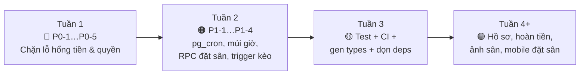

# 🔧 SportArena — Rà soát & việc cần làm tiếp

> Kết quả đọc toàn bộ schema SQL, Server Actions, webhook, RLS và các màn hình chính (tháng 10/2026).
> Sắp theo **mức độ nghiêm trọng**. Mỗi mục có *vấn đề → vì sao nguy hiểm → cách sửa*.
>
> **Kết luận ngắn:** 9 giai đoạn tính năng đã xong và build sạch. Điều còn thiếu **không phải tính năng mới**, mà là **bảo mật tầng database + độ tin cậy của luồng thanh toán** — cần làm trước khi cho người dùng thật dùng.

| Mức | Ý nghĩa |
| :-- | :-- |
| 🔴 P0 | Phải sửa trước khi chạy thật (mất tiền / bị lợi dụng) |
| 🟠 P1 | Lỗi nghiệp vụ sẽ xảy ra khi có nhiều người dùng |
| 🟡 P2 | Chất lượng code, hiệu năng, trải nghiệm |
| 🟢 P3 | Nên có để dự án chuyên nghiệp |

---

## 📌 Tiến độ Giai đoạn 10 (cập nhật 21/10/2026)

| Mục | Trạng thái | Ghi chú |
| :-- | :-- | :-- |
| P0-1 Xác nhận cọc không cần trả tiền | ✅ Đã sửa | Webhook bắt buộc chữ ký; bỏ nút "xác nhận ngay" và `confirmBookingDeposit`; giả lập chỉ ở dev khi chưa cấu hình PayOS |
| P0-2 Tự nâng quyền / tự duyệt / spam thông báo | ✅ Đã sửa | Thu hồi quyền ghi trực tiếp, cấp quyền theo cột, `role` chỉ nhận player/owner; đã kiểm thử bằng Postgres thật |
| P0-3 Webhook không ghi được DB | ✅ Đã sửa | Dùng `service_role`, idempotent, kiểm tra số tiền, trả 5xx để PayOS gọi lại. **Phát hiện thêm:** tích hợp PayOS cũ viết theo SDK v1 nên chưa từng chạy thật (luôn rơi về QR giả) — đã viết lại theo SDK v2 |
| P0-4 QR giả tới tài khoản cố định | ✅ Đã sửa | Production lỗi PayOS ⇒ báo lỗi, hủy đơn. Đã bỏ số tài khoản cứng trong giao diện |
| P0-5 Tài khoản mẫu / khóa nhúng cứng | 🟡 Một phần | Mobile: nút đổi tài khoản chỉ ở `__DEV__`, khóa Supabase chuyển sang `.env`. **Còn lại (việc của bạn):** đổi/xóa tài khoản seed trên DB production, tách DB dev/prod |
| P1-1 Đơn hết hạn khóa sân mãi | ✅ Đã sửa | `expire_pending_bookings()` + `pg_cron` mỗi phút + dọn lười mỗi lần đặt sân |
| P1-2 Sai múi giờ | ✅ Đã sửa | `lib/datetime.ts` + `lib/pricing.ts` tính theo giờ VN; kiểm tra giờ mở cửa ở server |
| P1-3 Tạo đơn không rollback | ✅ Đã sửa | Rollback khi lỗi tạo kèo/thanh toán; `orderCode` cấp từ sequence |
| P1-4 Đếm người trong kèo | ✅ Đã sửa | Trigger tự tính `current_players`/`status`, khóa dòng chống duyệt quá số người |
| P1-5 Chat & đánh giá | ✅ Đã sửa | Chat chỉ cho chủ kèo + thành viên đã duyệt; chỉ người đã chơi (không phải chủ sân) mới đánh giá; giới hạn độ dài |
| P1-6 Đồng hồ máy khách | ✅ Đã sửa | Đếm ngược theo giờ server + polling dự phòng khi Realtime rớt |
| Lịch bận hiển thị sai (phát hiện thêm) | ✅ Đã sửa | RPC `get_busy_slots` — trước đây người chơi chỉ thấy đơn của chính mình |
| P2-5, P2-6, P2-8, P2-9 | ✅ Đã sửa | `proxy.ts`, gỡ `socket.io`, `.env.example` không còn bị ignore, `supabase/.temp` được ignore |
| P2 còn lại, P3 | ⏳ Chưa làm | Test tự động, `gen types`, `next/image`, hồ sơ người dùng, hoàn tiền, mobile đặt sân... |

**Quyết định nghiệp vụ đã chọn (có thể đổi):** mỗi người giữ tối đa 3 đơn chưa cọc; đặt tối đa 6 giờ/đơn và trước tối đa 60 ngày; được đánh giá khi đơn đã `completed` hoặc đã `confirmed` và qua giờ kết thúc; giá tính theo khung giờ của thời điểm **bắt đầu** (như cũ); tiền về sau khi đơn hết hạn thì cố giữ lại sân, nếu sân đã bị người khác đặt thì đánh dấu `needs_refund` và báo người dùng.

---
## 🔴 P0 — Bảo mật & thanh toán

### P0-1. Ai cũng có thể "xác nhận đã cọc" mà không trả tiền
Có **3 đường** để bỏ qua việc thanh toán:

1. [webhook/route.ts](web/src/app/api/payos/webhook/route.ts) — nếu body có `orderCode` thì **tin luôn, không kiểm tra chữ ký**. Chỉ cần `POST {"orderCode": 123456}`.
2. [payos.ts:84](web/src/lib/payos.ts#L84) — khi xác thực chữ ký thất bại, code vẫn rơi xuống nhánh "payload mô phỏng" và chấp nhận `body.data.orderCode`.
3. [booking-payment-view.tsx:339](web/src/components/booking/booking-payment-view.tsx#L339) — nút **"Tôi Đã Chuyển Khoản (Xác Nhận Ngay)"** hiện cho mọi người, và `confirmBookingDeposit()` ([booking.ts:189](web/src/app/actions/booking.ts#L189)) không kiểm tra gì.

**Cách sửa:** chỉ chấp nhận webhook khi `verifyPaymentWebhookData` thành công; bọc nhánh mô phỏng trong `if (process.env.NODE_ENV !== 'production')`; ẩn/xóa nút xác nhận và `confirmBookingDeposit` ở production; kiểm tra `amount` PayOS trả về khớp với `payments.amount`.

### P0-2. Người dùng có thể tự nâng quyền, tự duyệt, tự xác nhận qua API Supabase
`anon key` là công khai (nằm trong app mobile và trình duyệt), nên ai cũng gọi thẳng được REST API. RLS hiện tại quá rộng:

| Bảng | Policy hiện tại | Hậu quả |
| :-- | :-- | :-- |
| `profiles` | `UPDATE USING (auth.uid() = id)` – không giới hạn cột | Tự đặt `role = 'admin'` |
| `handle_new_user()` | Tin `raw_user_meta_data.role` | Đăng ký trực tiếp với `role: 'admin'` |
| `bookings` | Chủ đơn được `UPDATE` mọi cột | Tự đặt `status = 'confirmed'`, sửa `total_price`/`deposit_amount` về 0 |
| `match_participants` | Người xin vào được `UPDATE` hàng của mình | Tự đổi `status` thành `accepted` |
| `matches` | Chủ kèo `UPDATE` mọi cột | Sửa tay `current_players` |
| `notifications` | `INSERT WITH CHECK (true)` | Ai cũng spam thông báo cho người khác |

**Cách sửa:** (a) trigger/`handle_new_user` chỉ cho phép `player` hoặc `owner`, không bao giờ `admin`; (b) bỏ quyền `UPDATE` trực tiếp của người dùng trên `bookings`, `payments`, `match_participants.status`, `matches.current_players` — chuyển sang **hàm RPC `SECURITY DEFINER`** hoặc dùng `service_role` ở server; (c) thêm `WITH CHECK` + chỉ cấp quyền cột cần thiết (`REVOKE UPDATE` rồi `GRANT UPDATE (full_name, phone_number, avatar_url)`).

### P0-3. Webhook thật sự có chạy được không? (rất có thể là không)
Webhook dùng `createClient()` — client **theo cookie người dùng**. PayOS gọi webhook thì không có cookie ⇒ `auth.uid()` là `null` ⇒ RLS từ chối `UPDATE bookings`, và bảng `payments` **không có policy UPDATE nào**. Supabase trả về 0 dòng bị ảnh hưởng *mà không báo lỗi*, webhook vẫn trả `200 success`.

Ở chế độ mô phỏng nó "trông như chạy" vì người bấm nút chính là chủ đơn (được phép update `bookings`) và UI tự đổi sang "Thành công" ở phía client — nhưng `payments.status` rất có thể **vẫn là `pending`**.

**Cách sửa:** tạo `lib/supabase/admin.ts` dùng `SUPABASE_SERVICE_ROLE_KEY` (chỉ server) cho webhook và `createNotification`; kiểm tra `error` / số dòng cập nhật; trả `5xx` khi lỗi để PayOS tự gọi lại; xử lý **idempotent** (đã có check `status === 'paid'`, giữ nguyên).

### P0-4. Mã QR giả dẫn tới tài khoản cố định
Khi gọi PayOS lỗi (hoặc chưa cấu hình khóa), [payos.ts:61-72](web/src/lib/payos.ts#L61) âm thầm tạo QR tới số tài khoản **`0388888888`** và UI còn dự phòng `0987654321`. Ở production, người dùng thật sẽ chuyển tiền vào tài khoản không thuộc hệ thống.

**Cách sửa:** production mà thiếu khóa PayOS hoặc PayOS lỗi ⇒ **trả lỗi cho người dùng, hủy đơn**, tuyệt đối không dựng QR dự phòng. Chỉ giữ fallback khi `NODE_ENV === 'development'`.

### P0-5. Tài khoản mẫu & thông tin nhạy cảm
- Mật khẩu `123456` của `owner@sportarena.vn` nằm trong [DEPLOYMENT.md](DEPLOYMENT.md) và **được nhúng cứng trong app mobile** ([ProfileScreen.tsx:75](mobile/src/screens/ProfileScreen.tsx#L75), nút "Quick Switcher"). Bất kỳ ai cài app đều đăng nhập được vào tài khoản chủ sân trên database thật.
- `anon key` + URL Supabase viết cứng trong [mobile/src/lib/supabase.ts](mobile/src/lib/supabase.ts) (anon key vốn công khai nên chấp nhận được, nhưng nên chuyển sang `EXPO_PUBLIC_*`).

**Cách sửa:** bỏ Quick Switcher khỏi bản build release (bọc `__DEV__`), đổi/xóa tài khoản seed trên DB production, tách DB dev và prod.

---

## 🟠 P1 — Lỗi nghiệp vụ

### P1-1. Đơn "giữ chỗ" hết hạn vẫn khóa sân vĩnh viễn
Việc hủy đơn quá 15 phút chỉ do **đồng hồ trên trình duyệt** gọi `cancelExpiredBooking`. Người dùng đóng tab ⇒ đơn `pending` vẫn nằm đó, và ràng buộc chống trùng lịch tính cả `pending` nên **khung giờ bị khóa mãi** ([clubs/[id]/page.tsx:84](web/src/app/clubs/[id]/page.tsx#L84) cũng đang coi `pending` là kín).

**Cách sửa:** job `pg_cron` mỗi phút: `UPDATE bookings SET status='cancelled' WHERE status='pending' AND expires_at < now()` (kèm `payments` → `cancelled`). Chỉ cần ~5 dòng SQL, giá trị cực cao.

### P1-2. Sai giờ vì múi giờ
[booking.ts:80-81](web/src/app/actions/booking.ts#L80) dùng `startDate.toTimeString()` và `getDay()` — chạy theo múi giờ của **server**. Vercel chạy UTC, Việt Nam là UTC+7 ⇒ khung "giờ vàng 17h–21h" khớp sai (đặt 18:00 bị tính thành 11:00), cuối tuần cũng lệch ngày với đơn gần nửa đêm.

**Cách sửa:** quy đổi cố định `Asia/Ho_Chi_Minh` (`Intl.DateTimeFormat` với `timeZone`, hoặc `date-fns-tz`) khi tính giá, hiển thị và lọc slot. Nên **tính giá trong một hàm SQL/RPC** để web và mobile dùng chung một nguồn.

### P1-3. Tạo đơn không có "rollback"
[createBooking](web/src/app/actions/booking.ts#L24) làm 3 việc liên tiếp (booking → match → payment) và **không kiểm tra lỗi** của 2 bước sau. Ví dụ: `orderCode` trùng ⇒ insert `payments` lỗi im lặng ⇒ người dùng thấy QR nhưng không có bản ghi thanh toán; webhook sau đó trả 404.

Ngoài ra `orderCode = 6 số cuối timestamp + random(0–999)` rất dễ trùng khi đông người.

**Cách sửa:** gộp thành **một RPC (transaction)** hoặc kiểm tra lỗi từng bước và hủy booking nếu bước sau hỏng; sinh `orderCode` từ sequence của Postgres.

### P1-4. Đếm người trong kèo có thể sai (race condition)
[respondParticipant](web/src/app/actions/matches.ts#L198) đọc `current_players`, cộng 1 rồi ghi lại. Hai lần duyệt đồng thời ⇒ mất một lượt đếm. Ngoài ra **không chặn duyệt quá `required_players`**, và `leaveMatch` luôn đặt kèo về `open` kể cả kèo đã `cancelled`.

**Cách sửa:** trigger Postgres tự tính `current_players = 1 + COUNT(accepted)` và `status` mỗi khi `match_participants` đổi — vừa đúng vừa bớt code ở app.

### P1-5. Chat & đánh giá chưa có kiểm soát
- Mọi người (kể cả chưa đăng nhập) **đọc được** chat mọi kèo; ai đăng nhập cũng **gửi được** vào kèo không tham gia.
- Ai cũng đánh giá được mọi sân dù chưa từng đặt; `content`/`comment` không giới hạn độ dài.

**Cách sửa:** RLS chat chỉ cho chủ kèo + thành viên `accepted`; chỉ cho review khi có booking `completed` tại cụm sân đó; thêm `CHECK (char_length(content) <= 1000)`.

### P1-6. Ngày hết hạn dựa vào đồng hồ máy khách
`timeLeft` trong [booking-payment-view.tsx](web/src/components/booking/booking-payment-view.tsx#L66) tính từ `Date.now()` của người dùng — đồng hồ máy lệch là đếm sai. Nên tính từ giờ server (gửi kèm `serverNow`) hoặc chỉ dựa vào `expires_at` + job ở P1-1.

---

## 🟡 P2 — Chất lượng code & hiệu năng

| # | Việc | Chi tiết |
| :-- | :-- | :-- |
| 1 | **Chưa có test nào** | Ít nhất viết test cho: tính giá, chống trùng lịch, webhook (chữ ký đúng/sai, gọi lặp), RLS (dùng `supabase test db`). |
| 2 | **32 chỗ dùng `any`** | `Database` types đã có nhưng nhiều query ép `as any`. Dùng `supabase gen types` để type tự sinh, bỏ ép kiểu. |
| 3 | **Lọc sân ở phía JS** | [clubs/page.tsx](web/src/app/clubs/page.tsx) tải *toàn bộ* cụm sân rồi lọc bằng `.filter()`. Chuyển điều kiện vào query Supabase + phân trang. |
| 4 | **Dùng `` thay `next/image`** | Mất tối ưu ảnh/lazy-load (đã cấu hình `remotePatterns` rồi nhưng chưa dùng). |
| 5 | **`middleware.ts` đã deprecated** | Next 16 yêu cầu đổi tên `proxy.ts`: `npx @next/codemod@canary middleware-to-proxy .` |
| 6 | **Phụ thuộc thừa/lệch** | `socket.io` + `socket.io-client` không được dùng ở đâu (Realtime đã do Supabase lo) → gỡ. `eslint-config-next` 16.3.5 lệch `next` 16.4.0. `shadcn` nên là `devDependency`. Package `cn` (npm) khác `lib/utils` của shadcn → 11 chỗ đang import từ `"cn"`, nên thống nhất một nguồn. |
| 7 | **Trùng migration** | `20261010…notifications_schema.sql` và `20261012…add_notifications.sql` cùng tạo bảng `notifications` (khác `DEFAULT type`). Giữ một file cho gọn lịch sử. |
| 8 | **`.env.example` bị `.gitignore` nuốt** | Dòng `.env*` chặn luôn file mẫu (GEMINI.md ghi là đã tạo, nhưng trên git không có). Thêm `!.env.example`. |
| 9 | **`supabase/.temp/` đang được commit** | Là file cache của CLI → thêm vào `.gitignore`. |
| 10 | **Metadata/SEO** | ✅ Đã sửa tiêu đề mặc định "Create Next App" và `lang="vi"` trong đợt nâng cấp giao diện. Còn thiếu ảnh Open Graph, `sitemap`, `robots`. |
| 11 | **Xử lý lỗi & trạng thái trống** | Nhiều server action trả `{error}` nhưng giao diện chưa hiện toast thống nhất; thiếu `error.tsx` / `not-found.tsx`. |
| 12 | **Realtime nặng** | Mỗi màn hình tự tạo channel riêng, một số lắng nghe cả bảng không có `filter` → lọc theo `club_id`/`match_id` để giảm tải. |

---

## 🟢 P3 — Nên làm tiếp để thành sản phẩm hoàn chỉnh

**Tính năng còn thiếu so với kỳ vọng của người dùng thật**
- Đăng ký bằng Google / số điện thoại (OTP), quên mật khẩu, xác thực email.
- Trang **hồ sơ người dùng** (đổi tên, ảnh đại diện, trình độ) — mới có ở mobile.
- **Hoàn tiền / hủy đơn** theo chính sách (hủy trước X giờ hoàn Y%), `payments.status = 'refunded'` đã có trong schema nhưng chưa có luồng.
- Chủ sân: **tải ảnh sân** lên Supabase Storage (hiện `images` là mảng URL nhập tay), chặn giờ bảo trì, báo cáo doanh thu theo tuần/tháng.
- **Nhắc lịch** trước giờ chơi (email/push) và **đánh dấu `completed` tự động** sau giờ kết thúc.
- Tìm sân **gần tôi** (bảng `clubs` đã có `latitude/longitude`) + bản đồ.
- Vai trò `admin` hiện chỉ tồn tại trong schema, chưa có trang quản trị.

**Mobile**
- Chưa có màn hình **đặt sân / thanh toán** (mới xem sân, xem kèo, xem lịch đã đặt).
- Thiếu **push notification** (Expo Notifications) và chat trong kèo.

**Vận hành**
- CI (GitHub Actions): `tsc --noEmit` + `eslint` + `next build` + test mỗi lần push.
- Giám sát lỗi (Sentry) và log webhook để truy vết thanh toán.
- Rate-limit cho webhook, đăng nhập, gửi chat (Vercel Firewall / Upstash).

---

## ✅ Thứ tự đề xuất

> Theo nguyên tắc "Logic First" trong [GEMINI.md](GEMINI.md), các mục chạm vào **nghiệp vụ** (chính sách hoàn tiền, ai được chat/review, cách chặn đơn quá hạn) nên được bạn xác nhận trước khi code.
