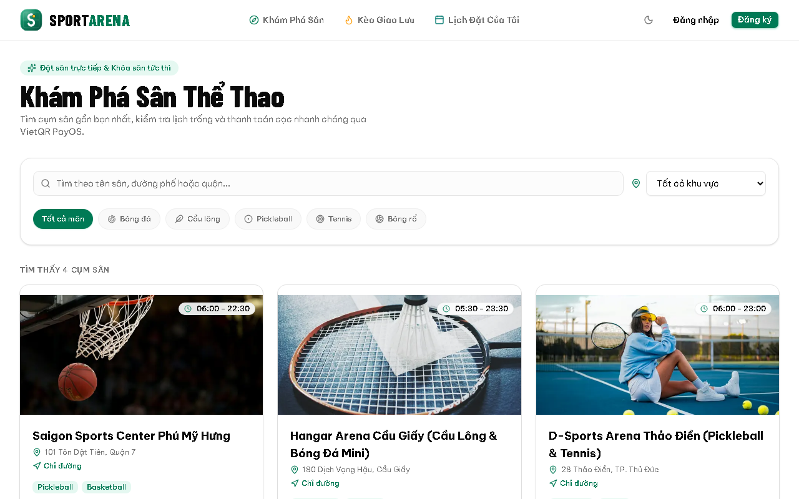
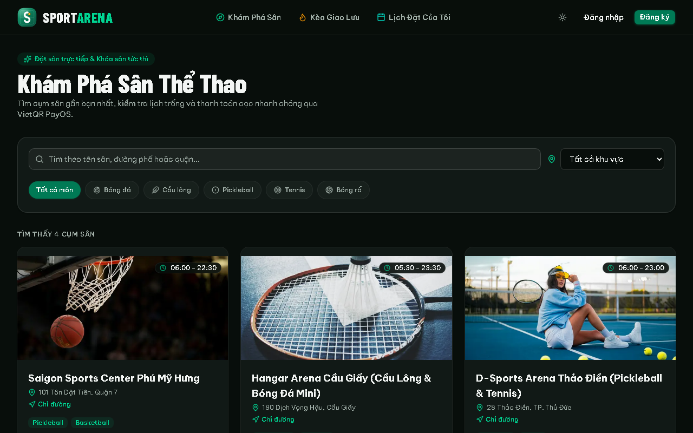
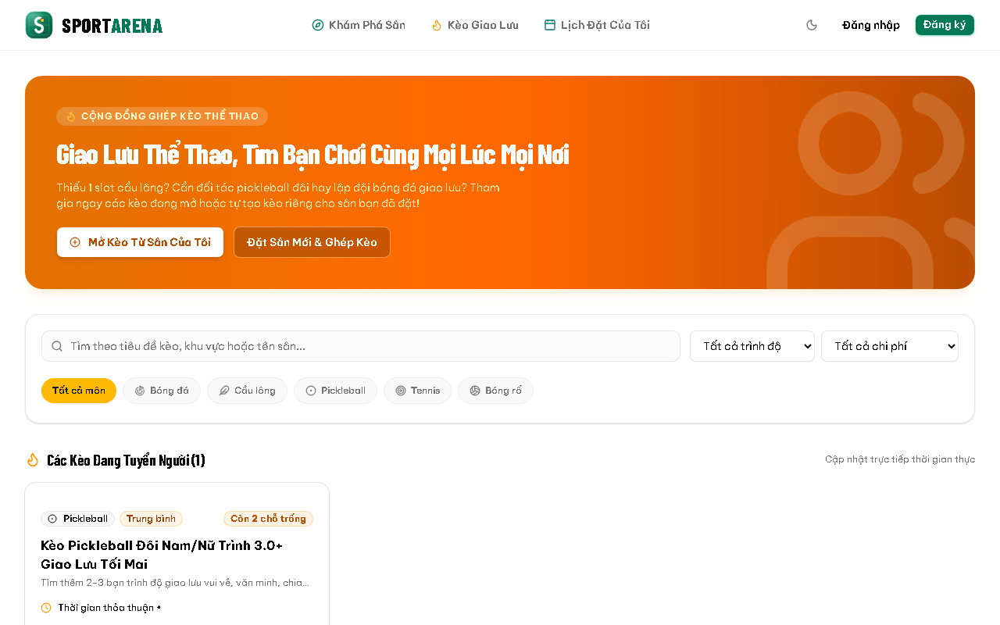
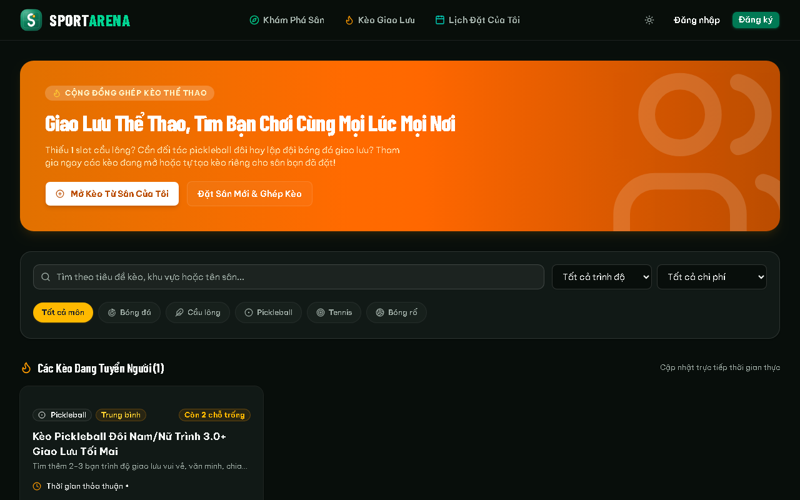

<div align="center">


# SportArena

**Đặt sân thể thao và ghép kèo giao lưu theo thời gian thực.**

Chọn giờ trống, cọc bằng mã VietQR, rủ thêm người chơi vào kèo. Mỗi chủ sân nhận tiền thẳng vào tài khoản của mình.

`Next.js 16` · `React 19` · `Tailwind v4` · `Supabase` · `PayOS` · `Expo`

</div>

<table>
  <tr>
    <td width="50%"></td>
    <td width="50%"></td>
  </tr>
  <tr>
    <td></td>
    <td></td>
  </tr>
</table>

## Tính năng

**Người chơi**
- Tìm cụm sân theo môn (bóng đá, cầu lông, pickleball, tennis, bóng rổ) và khu vực, xem bản đồ và chỉ đường.
- Chọn khung giờ trên lịch, hệ thống tự tính giá theo khung giờ và tiền cọc, giữ chỗ 15 phút có đồng hồ đếm ngược.
- Cọc bằng mã QR, trạng thái cập nhật ngay khi chuyển khoản xong, không cần tải lại trang.
- Mở kèo giao lưu ngay lúc đặt sân: chọn trình độ, chia tiền sân, chủ kèo duyệt từng người, chat trong kèo.
- Thông báo realtime, đánh giá sân, gửi yêu cầu hỗ trợ.

**Chủ sân**
- Quản lý cụm sân, sân con, ảnh, giờ mở cửa và vị trí.
- Bảng giá linh hoạt theo khung giờ và ngày trong tuần, tự đặt phần trăm cọc cho từng sân.
- Lịch đặt realtime, nhận thông báo khi có khách cọc.
- Tự kết nối kênh PayOS của mình để tiền cọc về thẳng tài khoản ngân hàng, không qua trung gian.
- Gói Free và Pro cho cụm sân.

**Quản trị nền tảng**
- Thống kê vận hành: người dùng, cụm sân, lượt đặt, giá trị giao dịch, doanh thu thuê gói, biểu đồ theo ngày.
- Hộp thư hỗ trợ (ticket) giữa quản trị với chủ sân và người chơi.
- Gửi thông báo cập nhật hoặc bảo trì tới từng nhóm người dùng.

**Giao diện**: sáng và tối, đủ tương phản chữ, dùng được trên điện thoại, có ứng dụng mobile bằng Expo.

## Điểm kỹ thuật đáng chú ý

- **Không bao giờ trùng lịch.** Chặn ở tầng Postgres bằng exclusion constraint trên khoảng thời gian, nên hai người bấm cùng lúc thì chỉ một người giữ được chỗ. Chỗ giữ quá hạn được nhả tự động bằng pg_cron.
- **Thanh toán đáng tin cậy.** Webhook PayOS kiểm tra chữ ký theo đúng kênh của từng đơn, đối chiếu số tiền, xử lý lặp an toàn (idempotent) và trả mã lỗi để PayOS tự gọi lại khi cần.
- **Mỗi chủ sân một kênh thanh toán.** Khóa PayOS được mã hóa AES-256-GCM trước khi lưu, chỉ server đọc được và không bao giờ trả về trình duyệt.
- **Bảo mật nhiều lớp.** Mọi bảng bật Row Level Security, người dùng không có quyền ghi trực tiếp vào bảng nghiệp vụ, mọi thao tác ghi đi qua Server Action có kiểm tra quyền. Các quy tắc đó có bộ test SQL riêng chạy trong Docker.
- **Realtime.** Lịch đặt, kèo, chat, thông báo và ticket cập nhật qua Supabase Realtime.
- **Múi giờ Việt Nam nhất quán.** Hiển thị và thống kê đều tính theo giờ Việt Nam, kể cả khi máy chủ chạy UTC.
- **Kiểm thử và CI.** Hơn 150 test Vitest cho logic nghiệp vụ, bộ test RLS bằng SQL, GitHub Actions chạy typecheck, lint, test, build và kiểm tra mobile ở mỗi lần push.

## Công nghệ

| Lớp | Công nghệ |
| :-- | :-- |
| Web | Next.js 16 (App Router, Server Actions), React 19, Tailwind CSS v4, shadcn/ui trên Base UI |
| Dữ liệu | Supabase: Postgres, Auth, RLS, Realtime |
| Thanh toán | PayOS v2 (VietQR) |
| Mobile | Expo, React Native |
| Kiểm thử | Vitest, test SQL trong Docker |
| Hạ tầng | Vercel hoặc Docker, GitHub Actions |

## Cấu trúc

```
web/        Ứng dụng Next.js (trang, Server Actions, webhook, giao diện, logic có test)
mobile/     Ứng dụng Expo
supabase/   Migration (schema, RLS, hàm SQL) và bộ test bảo mật
docs/       Ảnh minh họa
```

Tài liệu đi kèm: [Luồng hoạt động](FLOW.md) (có sơ đồ), [Quy chuẩn thiết kế](DESIGN.md), [Hướng dẫn triển khai](DEPLOYMENT.md).

## Chạy thử

Cần Node.js 20 trở lên và một project [Supabase](https://supabase.com) miễn phí. Chưa cần khóa PayOS: môi trường dev có chế độ giả lập thanh toán.

```bash
git clone https://github.com/tuan2304/pickleball-booking.git
cd pickleball-booking/web
npm install
cp .env.example .env.local        # điền 3 biến Supabase ở đầu file
```

Tạo schema trên project Supabase của bạn (cần [Supabase CLI](https://supabase.com/docs/guides/cli)), rồi chạy:

```bash
supabase link --project-ref <project-ref>
supabase db push
npm run dev                       # http://localhost:3000
```

Các lệnh khác, chạy trong `web/`:

| Lệnh | Việc làm |
| :-- | :-- |
| `npm run check` | Typecheck, lint và test, giống CI |
| `npm run db:test` | Áp migration lên Postgres tạm trong Docker và chạy test RLS |
| `npm run build` | Build production |

Ứng dụng mobile: `cd mobile && npm install && npm start`.

## Hướng phát triển

- Chính sách hủy sân và hoàn cọc.
- Thêm nhà cung cấp thanh toán khác ngoài PayOS.
- Đặt sân ngay trên ứng dụng mobile, hồ sơ người chơi, ảnh sân do chủ sân tải lên.
- SEO và phân trang danh sách sân khi số lượng lớn.
